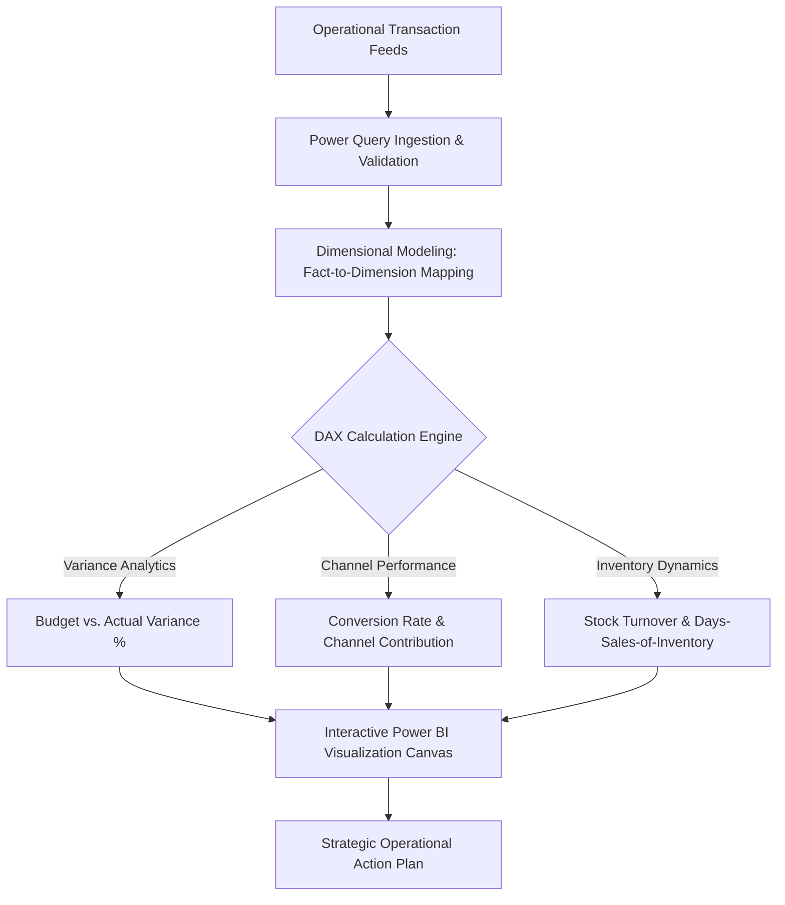

<div align="center">


[](https://powerbi.microsoft.com/)
[](https://learn.microsoft.com/en-us/dax/)
[](https://powerquery.microsoft.com/)
[](#)
[](#)

</div>

---

## 📌 Executive Summary / Overview

**Business Analytics Dashboard II** (`Business-Analytics-Exp-2`) provides a structured business intelligence case study developed in Microsoft Power BI. The project focuses on diagnostic business analytics, identifying revenue leakages, variance distributions, and multi-tier operational efficiencies across commercial entities.

By implementing advanced DAX calculations and tabular relational schema mappings, this dashboard translates complex operational transactional records into intuitive visual hierarchies. The analytical models assist commercial analysts in identifying underperforming product categories, benchmarking sales channel velocity, and optimizing seasonal inventory allocations.

---

## 📖 Interactive Table of Contents

- [Executive Summary / Overview](#-executive-summary--overview)
- [Key Features & Capabilities](#-key-features--capabilities)
- [System Architecture & Analytical Flow](#-system-architecture--analytical-flow)
- [Tech Stack Breakdown](#-tech-stack-breakdown)
- [Analytical Framework & Measures](#-analytical-framework--measures)
- [Reproducible Quickstart & Setup](#-reproducible-quickstart--setup)
- [Project Directory Layout](#-project-directory-layout)
- [Author & Contributions](#-author--contributions)

---

## ✨ Key Features & Capabilities

- **Comparative Operational Benchmarking**: Quantifies variance between targeted budgetary benchmarks and actual transactional receipts across departmental units.
- **Hierarchical Drill-Downs**: Configured interactive matrix and funnel views supporting granular drill-downs from macroeconomic divisions down to individual product SKUs.
- **Parametric What-If Analysis**: Implements dynamic parameters to simulate pricing fluctuations, margin elasticities, and operational discount scenarios.
- **Data Integrity & Normalization**: Utilizes Power Query to enforce relational normalization, eliminate redundant keys, and validate data types.
- **Context-Aware Visual Tooltips**: Delivers secondary visual drill-downs embedded within hover tooltips for zero-click managerial exploration.

---

## 🏗️ System Architecture & Analytical Flow



---

## 🛠️ Tech Stack Breakdown

| Category | Technologies & Tools |
| :--- | :--- |
| **Business Intelligence** | Microsoft Power BI Desktop |
| **Expression Language** | DAX (Filter Context, Calculated Columns, Measures) |
| **Data Ingestion** | Power Query M Engine |
| **Modeling Methodology** | Relational Star Schema, Dimensional Fact Modeling |
| **Visualization Layout** | Heatmaps, Waterfall Charts, Clustered Column Visuals |

---

## 📈 Analytical Framework & Measures

| DAX Metric / Concept | Computational Purpose | Business Outcome |
| :--- | :--- | :--- |
| **Sales Variance** | `[Total Sales] - [Budgeted Sales]` | Real-time tracking of commercial quota shortfalls |
| **Variance %** | `DIVIDE([Sales Variance], [Budgeted Sales], 0)` | Normalized departmental efficiency comparisons |
| **Channel Velocity** | `DIVIDE([Sales], [Transaction Count], 0)` | Basket size optimization across online vs. retail channels |
| **Cumulative Run-Rate** | `TOTALYTD([Total Revenue], 'Calendar'[Date])` | Fiscal year revenue forecasting and trajectory monitoring |

---

## 🚀 Reproducible Quickstart & Setup

### Prerequisites
- Microsoft Power BI Desktop installed on Windows.

### Step 1: Clone the Repository
```bash
git clone https://github.com/Jeshwanthika07/Business-Analytics-Exp-2.git
cd Business-Analytics-Exp-2
```

### Step 2: Open Dashboard File
1. Launch `Experiment 2.pbix` in Microsoft Power BI Desktop.
2. Explore interactive slicers, drill-down matrices, and waterfall variance charts.

---

## 📂 Project Directory Layout

```text
Business-Analytics-Exp-2/
│
├── Experiment 2.pbix          # Power BI dashboard, data models & visual layouts
└── README.md                  # Comprehensive technical documentation
```

---

## 👩‍💻 Author & Contributions

Curated by **[Jeshwanthika Pothamchetty](https://github.com/Jeshwanthika07)**  
*Alliance University | Department of Computer Applications*

<div align="center">


</div>
